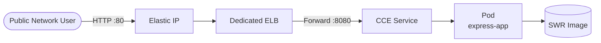

# Containerized Express Web App Deployment Practice (Huawei Cloud CCE)


## Introduction

This repository provides a best-practice approach for running a stateless Node.js (Express) web application on Huawei Cloud: containerize the application and run it on CCE (Cloud Container Engine), exposing it externally through a dedicated-mode Elastic Load Balance (ELB). It is suitable for scenarios where you want to quickly host a lightweight web service on managed Kubernetes while gaining elastic scaling and high-availability capabilities.

## Table of Contents

- [Architecture Diagram](#architecture-diagram)
- [Highlights](#highlights)
- [Cloud Services Used](#cloud-services-used)
- [Prerequisites](#prerequisites)
- [Quick Start](#quick-start)
- [Step-by-Step Deployment](#step-by-step-deployment)
- [Usage / Verification](#usage--verification)
- [Cleanup](#cleanup)
- [Details](#details)
- [Dependencies and Acknowledgements](#dependencies-and-acknowledgements)
- [FAQ / Troubleshooting](#faq--troubleshooting)
- [Contributing](#contributing)
- [License](#license)
- [Submitter](#submitter)

## Architecture Diagram



## Highlights

- **Consistent capability, ready to use**: standard Kubernetes workloads host stateless web services, with capabilities on par with managed deployment platforms.
- **Infrastructure as Code**: network, cluster, node pool, and load balancer are all declared with Terraform, enabling repeatable creation and teardown.
- **Health checks and rolling releases**: the application has a built-in `/healthz` probe, and the Deployment performs rolling updates to guarantee zero-downtime releases.
- **Secure and compliant**: credentials are injected via environment variables and never persisted to disk; the external entry point can be narrowed to operations sources via a security group.

## Cloud Services Used

This practice uses the following Huawei Cloud services:

- **CCE (Cloud Container Engine)**: managed Kubernetes cluster and node pool that runs the application containers.
- **SWR (Container Image Service)**: stores and distributes the application container images.
- **ELB (Elastic Load Balance)**: a dedicated-mode load balancer that provides a public entry point and forwards traffic to the Service.
- **EIP (Elastic IP)**: binds a public address to the load balancer.
- **VPC / Subnet / Security Group**: network isolation and access control.

> Please release resources promptly after use to avoid unnecessary environment residue.

## Prerequisites

- A Huawei Cloud account with the corresponding regional permissions (to create CCE, ELB, EIP, VPC, etc.).
- Local tools: Terraform (>= 1.5), kubectl, a container engine (docker / nerdctl), and the Huawei Cloud CLI.
- An organization already created in SWR, with the organization name and region recorded.
- Authentication environment variables configured:
  ```bash
  export HW_ACCESS_KEY="<your-access-key>"
  export HW_SECRET_KEY="<your-secret-key>"
  ```

## Quick Start

```bash
# 1. Build and push the image to SWR (replace <region> and <organization>)
cd src/app
docker build -t swr.<region>.myhuaweicloud.com/<organization>/express-app:latest .
docker push swr.<region>.myhuaweicloud.com/<organization>/express-app:latest
cd ../..

# 2. Create the infrastructure
cd infra
terraform init && terraform apply
cd ..

# 3. Deploy the workload
export NAMESPACE=$(terraform -chdir=infra output -raw namespace)
export ELB_ID=$(terraform -chdir=infra output -raw elb_id)
export SWR_IMAGE=swr.<region>.myhuaweicloud.com/<organization>/express-app:latest
envsubst < src/workloads/express-deployment.yaml | kubectl apply -f -
```

## Step-by-Step Deployment

For detailed step-by-step commands (including kubeconfig retrieval, variable injection, and status verification), see [`docs/deployment-guide.md`](docs/deployment-guide.md).

## Usage / Verification

After deployment, access the application via the load balancer's public address:

```bash
# Get the public IP bound to the ELB
ELB_EIP=$(terraform -chdir=infra output -raw elb_eip_address)

# Access the application root path
curl http://$ELB_EIP/
# Expected output: Hello World!

# Health check endpoint
curl -I http://$ELB_EIP/healthz
# Expected: HTTP/1.1 200 OK
```

> **Verification tip**: After deployment, please verify on your own by following the steps above and confirm the business functionality works (returns `Hello World!`, health check returns 200) before considering delivery complete.

## Cleanup

After verification, it is recommended to release resources to avoid environment residue:

```bash
cd infra
terraform destroy
```

You can also delete unwanted image versions in the image repository console.

## Details

- **Application code**: under `src/app/` is a pure Express application (`app.js` + `package.json` + `Dockerfile`) with no cloud-vendor dependencies.
- **Image build**: based on the official Node.js runtime image, installing only production dependencies, exposing port 8080.
- **Workload**: `src/workloads/express-deployment.yaml` defines the Deployment (with readiness/liveness probes) and the Service (LoadBalancer + ELB annotations).
- **Infrastructure**: under `infra/`, Terraform declares the VPC, subnet, security group, CCE cluster, node pool, namespace, dedicated ELB, and elastic IP.
- **Horizontal scaling (optional)**: configure an HPA for the Deployment to autoscale by CPU utilization; the node pool can be deployed across availability zones to improve availability.

## Dependencies and Acknowledgements

- [Express](https://expressjs.com/): web application framework.
- [Node.js](https://nodejs.org/): JavaScript runtime.
- Huawei Cloud-native services such as the Container Image Service and Cloud Container Engine.

## FAQ / Troubleshooting

- **Pod never becomes ready**: check whether the image address is correct, whether the node can pull the same-region SWR image, and whether the security group allows the application port.
- **No response when accessing the ELB address**: confirm that the Service's `kubernetes.io/elb.id` annotation holds the real value from `terraform output elb_id`, and that the ELB has an elastic IP bound.
- **`terraform init` is slow or fails**: in offline environments, configure a local provider override (dev_overrides) to skip network downloads.

## Contributing

Improvements via issues and PRs are welcome; see [CONTRIBUTING](CONTRIBUTING.md) for details.

## License

This practice is released under the **MIT No Attribution** license.

[](LICENSE)

See the [`LICENSE`](LICENSE) file at the repository root for details.

## Submitter

- Submitter: zhangcheng123321
