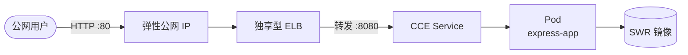

# Express Web 应用容器化部署实践（华为云 CCE）


## 简介

本仓库提供一套在华为云上落地无状态 Node.js（Express）Web 应用的最佳实践：将应用容器化后运行于 CCE（云容器引擎），并通过独享型弹性负载均衡（ELB）对外暴露服务。适用于希望以托管 Kubernetes 方式快速托管轻量 Web 服务、并获得弹性扩缩与高可用能力的场景。

## 目录

- [架构图](#架构图)
- [方案亮点](#方案亮点)
- [涉及云服务](#涉及云服务)
- [前置条件](#前置条件)
- [快速开始](#快速开始)
- [分步部署](#分步部署)
- [使用方法 / 验证](#使用方法--验证)
- [清理资源](#清理资源)
- [详细说明](#详细说明)
- [依赖与致谢](#依赖与致谢)
- [FAQ / 故障排除](#faq--故障排除)
- [贡献指南](#贡献指南)
- [许可证](#许可证)
- [提交者](#提交者)

## 架构图



## 方案亮点

- **能力一致、开箱即用**：以标准 Kubernetes 工作负载承载无状态 Web 服务，能力与托管式部署平台一致。
- **基础设施即代码**：网络、集群、节点池、负载均衡全部以 Terraform 声明，可重复创建与释放。
- **健康检查与滚动发布**：应用内置 `/healthz` 探针，Deployment 滚动更新保证零停服发布。
- **安全合规**：凭据经环境变量注入，不落盘；对外入口可经安全组收敛到运维来源。

## 涉及云服务

本实践涉及以下华为云服务：

- **CCE（云容器引擎）**：托管 Kubernetes 集群与节点池，运行应用容器。
- **SWR（容器镜像服务）**：存放与分发应用容器镜像。
- **ELB（弹性负载均衡）**：独享型负载均衡，提供公网入口并转发流量到 Service。
- **EIP（弹性公网 IP）**：为负载均衡绑定公网地址。
- **VPC / 子网 / 安全组**：网络隔离与访问控制。

> 资源使用完毕后请及时释放，避免产生不必要的环境残留。

## 前置条件

- 华为云账号及相应区域权限（创建 CCE、ELB、EIP、VPC 等）。
- 本地工具：Terraform（>= 1.5）、kubectl、容器引擎（docker / nerdctl）、华为云命令行工具。
- 已在 SWR 创建组织并记录组织名与区域。
- 已配置鉴权环境变量：
  ```bash
  export HW_ACCESS_KEY="<your-access-key>"
  export HW_SECRET_KEY="<your-secret-key>"
  ```

## 快速开始

```bash
# 1. 构建并推送镜像到 SWR（替换 <区域> 与 <组织>）
cd src/app
docker build -t swr.<区域>.myhuaweicloud.com/<组织>/express-app:latest .
docker push swr.<区域>.myhuaweicloud.com/<组织>/express-app:latest
cd ../..

# 2. 创建基础设施
cd infra
terraform init && terraform apply
cd ..

# 3. 部署工作负载
export NAMESPACE=$(terraform -chdir=infra output -raw namespace)
export ELB_ID=$(terraform -chdir=infra output -raw elb_id)
export SWR_IMAGE=swr.<区域>.myhuaweicloud.com/<组织>/express-app:latest
envsubst < src/workloads/express-deployment.yaml | kubectl apply -f -
```

## 分步部署

详细的分步命令（含 kubeconfig 获取、变量注入、状态校验）见 [`docs/deployment-guide.md`](docs/deployment-guide.md)。

## 使用方法 / 验证

部署完成后，通过负载均衡的公网地址访问应用：

```bash
# 获取 ELB 绑定的公网 IP
ELB_EIP=$(terraform -chdir=infra output -raw elb_eip_address)

# 访问应用根路径
curl http://$ELB_EIP/
# 预期输出：Hello World!

# 健康检查端点
curl -I http://$ELB_EIP/healthz
# 预期：HTTP/1.1 200 OK
```

> **验证提示**：请在部署完成后按上述步骤自行验证，确认业务功能可用（返回 `Hello World!`、健康检查返回 200），方可视为交付完成。

## 清理资源

验证完成后，建议释放资源以避免环境残留：

```bash
cd infra
terraform destroy
```

同时可在镜像仓库控制台删除不再需要的镜像版本。

## 详细说明

- **应用代码**：`src/app/` 下为纯 Express 应用（`app.js` + `package.json` + `Dockerfile`），无云厂商依赖。
- **镜像构建**：基于官方 Node.js 运行时镜像，仅安装生产依赖，暴露 8080 端口。
- **工作负载**：`src/workloads/express-deployment.yaml` 定义 Deployment（含就绪/存活探针）与 Service（LoadBalancer + ELB 注解）。
- **基础设施**：`infra/` 下 Terraform 声明 VPC、子网、安全组、CCE 集群、节点池、命名空间、独享型 ELB 与弹性公网 IP。
- **横向扩缩（可选）**：为 Deployment 配置 HPA 即可按 CPU 利用率自动扩缩；节点池可跨可用区部署提升可用性。

## 依赖与致谢

- [Express](https://expressjs.com/)：Web 应用框架。
- [Node.js](https://nodejs.org/)：JavaScript 运行时。
- 容器镜像服务、云容器引擎等华为云原生服务。

## FAQ / 故障排除

- **Pod 一直未就绪**：检查镜像地址是否正确、节点能否拉取 SWR 同区域镜像、安全组是否放通应用端口。
- **访问 ELB 地址无响应**：确认 Service 的 `kubernetes.io/elb.id` 注解填写的是 `terraform output elb_id` 的真实值，且 ELB 已绑定弹性公网 IP。
- **terraform init 慢或失败**：离线环境可配置 provider 本地覆盖（dev_overrides）跳过网络下载。

## 贡献指南

欢迎通过 issue 与 PR 参与改进，详见 [CONTRIBUTING](CONTRIBUTING.md)。

## 许可证

本实践采用 **MIT No Attribution** 许可证。

[](LICENSE)

详见仓库根目录 [`LICENSE`](LICENSE) 文件。

## 提交者

- 提交者：zhangcheng123321
