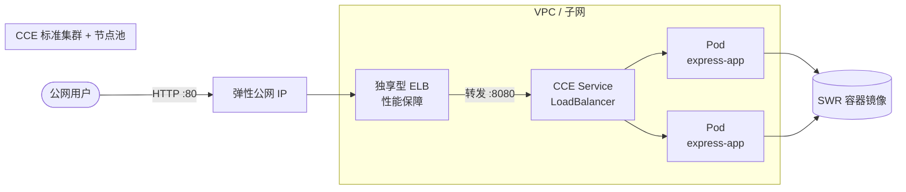

# 架构说明

本实践演示如何将一个无状态 Node.js（Express）Web 应用以容器化方式运行在华为云 CCE（云容器引擎）上，并通过独享型弹性负载均衡（ELB）对外暴露服务。

## 总体架构

## 分层说明

| 层 | 组件 | 职责 |
|-|-|-|
| 接入层 | 弹性公网 IP + 独享型 ELB | 为集群 Service 提供公网可达的固定入口 |
| 集群层 | CCE 标准集群 + 节点池 | 托管 Kubernetes，运行应用 Pod；节点池规格显式写死便于估算 |
| 工作负载层 | Deployment + Service | 以容器镜像运行 Express 应用；Service 经 ELB 注解复用预建负载均衡 |
| 镜像层 | SWR 容器镜像仓库 | 存放构建好的应用镜像，集群内拉取 |

## 关键设计点

- **无状态**：应用不持久化本地状态，可任意横向扩缩与滚动发布。
- **健康检查**：应用暴露 `/healthz` 端点，Deployment 配置就绪/存活探针，ELB 仅将流量转发到就绪 Pod。
- **对外暴露**：Service 使用 `type: LoadBalancer` 并注解 `kubernetes.io/elb.id` 复用 Terraform 预建的独享型 ELB，80 端口映射到容器 8080。
- **镜像拉取**：集群节点通过 SWR 同区域镜像仓库拉取镜像，无需额外出网配置。

## 扩展方向（可选，非本样例范围）

- 横向扩缩：为 Deployment 配置 HPA（基于 CPU 利用率）。
- 可观测：接入 CCE 插件与云日志服务（LTS）归集日志与指标。
- 多副本高可用：将节点池跨可用区部署并提升副本数。
